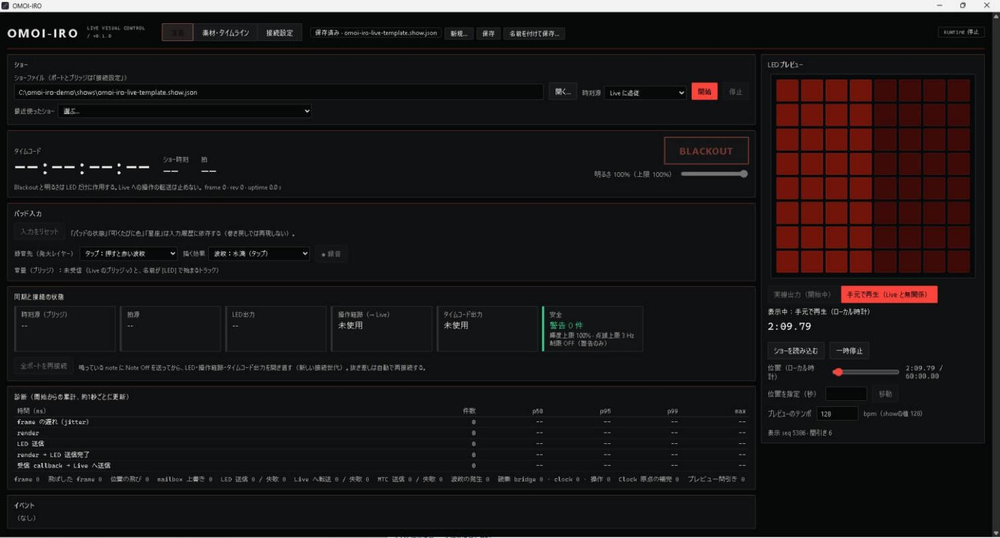
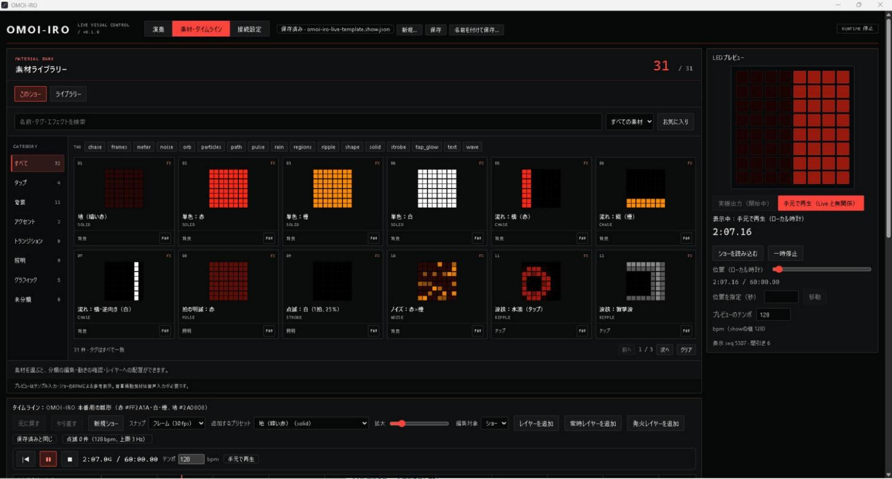
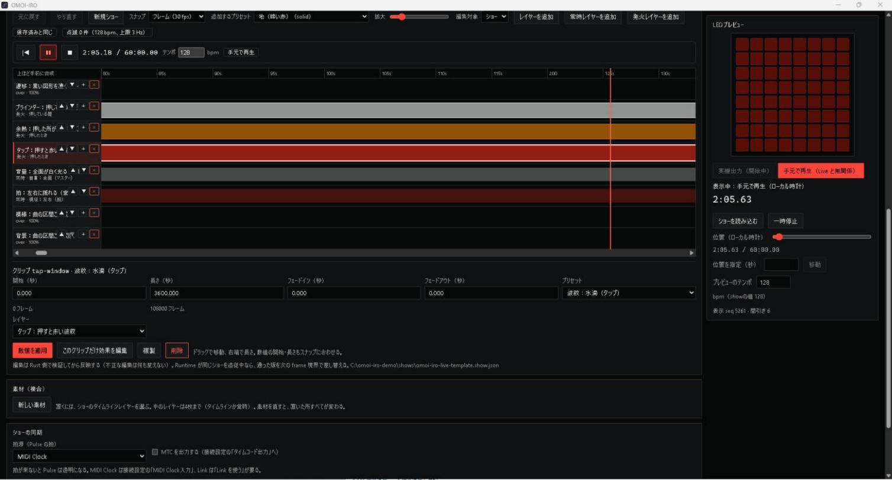

# OMOI-IRO（作業名：DJ Show Control）

Ableton Liveを再生マスターとして、MIDIコントローラーの操作入力とLED演出を管理するデスクトップアプリの開発プロジェクトです。製品名はOMOI-IRO（2026-10-28決定。赤をテーマカラーとし、「思い」をテーマにした音楽イベントのために、Launchpad Xをキャンバスに見立てて演出する）。設計資料では作業名「DJ Show Control」を使っています。

OMOI-IROは個人のオープンソースプロジェクトで、ソニーグループ株式会社およびその商標「Omoiiro」とは無関係です。表記は常に「OMOI-IRO」を用います。

2026年10月28日にP0（技術検証）を完了し、本番アプリ（[実装計画](docs/11-implementation-plan.md)）を実装しました。Cargo workspace（`crates/`、`apps/probe`）、Tauri 2 + React のデスクトップアプリ（`apps/desktop/`）、Live側スクリプト（`live-bridge/`）があります。2026年10月29日の本番ではMac（Apple Silicon）でLaunchpad Xを点灯させて運用しました（[結果](docs/validation/m6-results.md)）。ビルドとテストの手順は [BUILD.md](BUILD.md)。

## 画面

Windows版 v0.1.0（2026-10-29）。ショーは同梱の雛形 `shows/omoi-iro-live-template.show.json`。

| 演奏タブ | 素材ライブラリー |
| --- | --- |
|  |  |

- 演奏タブ：ショーファイルを選んで「開始」。時刻源は「Live に追従」か「手元の時計（Live なし）」。LEDプレビューは実機へ送っている値を映す。
- 素材ライブラリー：ショー内の素材と、ショー横断のライブラリー（`shows/omoi-iro-library-*.show.json`、160素材）を切り替えて探し、タイムラインのレイヤーへ置く。
- タイムライン：クリップをドラッグで移動・伸縮・別レイヤーへ移動。Space で再生、Delete で削除、⌘Z / Ctrl+Z で取り消し。

## 合意した前提

- Ableton Live 12 Suiteを使用する。
- Arrangement ViewとSession ViewをMVPから同等に扱う。
- 両ビューの演出はセット全体の共通タイムコードに追従する。クリップごとの再生位置追従は初期対象に含めない。
- Launchpad XはアプリがProgrammer Modeで管理し、操作をLiveへ転送する。
- LTCからMTCへの変換は、必要な場合の代替案として検討できる。
- Abletonの同期機構も利用可能。拍同期はAbleton Linkを第一候補として検証する。
- Core EngineはRust、GUIはTauri 2とReact / TypeScript。初期対応はWindowsとmacOS。
- タイムコードは30 fpsが暫定候補。開始時刻は未定。
- Windowsは10または11を想定。MacはApple Siliconを対象とする。具体的なOS版は未確認。
- MacとLaunchpad Xの実機検証環境はあるが、放置運転はできない。立ち会い可能な短い検証枠で進める。

## 設計資料

Claudeへ引き継ぐ場合は[引き継ぎ設計とP0仕様](docs/09-claude-handoff.md)を入口にし、[貼り付け用プロンプト](prompts/claude-p0.md)を使ってください。プロンプトはP0の最小実装と検証を依頼する内容です。この資料作成ではアプリコードを生成していません。

| 資料 | 内容 |
| --- | --- |
| [技術実現性調査](docs/00-feasibility.md) | 公式資料、制約、接続案、実機検証項目 |
| [PRD](docs/01-prd.md) | 利用目的、MVP範囲、受け入れ条件 |
| [システムアーキテクチャ](docs/02-architecture.md) | 同期、実行モデル、合成、障害処理 |
| [Rustクレートとモジュール](docs/03-modules.md) | 依存方向、責務、拡張インターフェース |
| [ショーデータ仕様案](docs/04-show-data.md) | 時間、エフェクト、プリセット、保存と互換性 |
| [MVPロードマップ](docs/05-roadmap.md) | 段階別の成果物と完了条件 |
| [実装タスク](docs/06-tasks.md) | 依存関係、成果物、検証方法 |
| [設計判断と未決事項](docs/07-decisions.md) | 合意済み事項、提案、実装前の検証ゲート |
| [Ableton Linkの採用案](docs/08-ableton-link.md) | LinkとMTCの役割、接続・途中参加・Rust連携 |
| [Claude向け引き継ぎ](docs/09-claude-handoff.md) | 設計の要点、P0の実施順、CLI仕様、検証記録と完了条件 |
| [Liveブリッジ仕様](docs/10-live-bridge.md) | 共通時計の改訂（2026-10-28）。Live内スクリプトの曲中時刻サンプル、アプリによるMTC生成、P1の実装範囲 |
| [実装計画](docs/11-implementation-plan.md) | 試作から本番アプリへの移行（2026-10-28）。構成、マイルストーンM1〜M6、分担、進捗 |
| [元要件との対応](docs/12-original-requirements.md) | 利用者の元要件（タイムライン・モジュール・ノードグラフ）と現在の実装の対応表。MVPで外した項目と確保する余地 |
| [プリセット制作ガイド](docs/13-preset-authoring.md) | GUIを使わずJSONでプリセットとパレット用ショーを量産する手引き（Codex等の並行制作向け）。Schema 0.1.2の演出一覧、規則、CLIでの確認 |
| [演出60案の対応表と拡張計画](docs/14-effects-roadmap.md) | Codex案の60演出を「今すぐ／小拡張／新基盤／外部入力」に分類。小拡張の仕様と基盤の順序（2026-10-28） |
| [P0 環境調査](docs/validation/environment.md) | Windows側の確認値と未確認値（2026-10-28） |
| [P0 検証手順書](docs/validation/p0-runbook.md) | Liveなしの確認、Windows + Live 12、Macの短時間枠 |
| [P0 検証結果](docs/validation/p0-results.md) | Windows実測（Live 12 + LiveMTC、Link、代替ブリッジ計測）とnot-run項目 |
| [Q01 通し試験の結果](docs/validation/q01-results.md) | 機器なしの通し試験（M5、合成源）。headless 23項目とGUI 6項目、10分soak |
| [M6 手順書](docs/validation/m6-runbook.md) | 実機と長時間：Launchpad X、Live追従を本番アプリで、2時間試験、Mac枠 |
| [M6 結果](docs/validation/m6-results.md) | 実機の結果。Windows本番アプリでのC1〜C7（合格）、連続試験、Mac |
| [本番前日の計画（Mac）](docs/validation/m6-mac-showday.md) | 2026-10-29の本番に向けた順序。Macのビルドと接続、LPX、ショーデータ、本番の起動手順と緊急時の対応 |

[JSON Schema案](schemas/show.schema.json)と[サンプルショー](examples/demo.show.json)は、設計レビュー用のデータ成果物です。アプリの実装ではありません。

検証用CLI `omoiiro-probe`（旧 `p0-probe`）は [apps/probe](apps/probe/README.md) にあり、`crates/omoiiro-*` の上に載る薄いCLIです。Live側のRemote Script `OmoiIroBridge`（旧 `DJSCBridge`）は [live-bridge](live-bridge/README.md)。仮想MIDIポート名は `OMOI-IRO Control` / `OMOI-IRO Timecode` / `OMOI-IRO Clock`（2026-10-28のM5冒頭で `DJSC` から改名。`artifacts/p0` の実測記録とP0の検証文書は旧名のまま）。実験用のコードは `tools/` に残しています。

- [ビルドとテスト（Cargo workspace）](BUILD.md) — workspaceの構成、通常のビルド、Link付きビルドの手順

## 最初の判断

基本構成は実現可能です。2026-10-28のWindows実測を経て、共通時計はLive内のRemote Scriptが送る曲中時刻サンプル、Ableton Linkは拍・テンポの入力、MTCはアプリが外部機器向けに生成する出力、という構成に改訂しました（[Liveブリッジ仕様](docs/10-live-bridge.md)）。LiveMTCはテンポ変更で時刻が飛ぶため不採用です。MIDI ClockはLinkを利用できない場合の選択肢として残します。[Linkの同期モデル](https://ableton.github.io/link/)、[LiveMTCの仕様](https://support.showsync.com/sync-tools/livemtc/introduction)

次の工程は設計レビューと接続・同期の小規模検証です。ロードマップとタスクは実装を開始する際の計画であり、現時点の実測結果ではありません。

## 設計成果物の確認

JSON SchemaがDraft 2020-12として有効であること、サンプルのSchema適合とID参照・時間区間の整合を確認済みです。未知キー、不正色、ゼロのduration、未知Effect、範囲外opacity、曖昧なcontent、未対応version、安全な整数範囲外の8種類の不正データが拒否されることも確認しました。ローカル文書リンクは検査済みです。機器通信、Live同期、性能目標の実測は次工程です。
