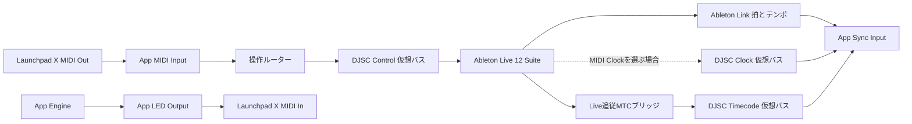

# OMOI-IRO 技術実現性調査

確認日：2026年10月27日。公式資料から確認できる仕様と、このプロジェクトで採用する設計案を分けて記す。ハードウェア通信、Liveとの接続、遅延計測は未実施。

## 結論

RustとTauri 2での実現は可能と判断する。成立条件は、LiveからのMTC送信を外部ブリッジで補い、Launchpad Xの管理をアプリに集約すること。最大の不確定要素は、共通タイムコードがSession演奏・テンポ変更・ループ・シークで期待どおり振る舞うかである。

| 対象 | 判定 | 設計への影響 |
| --- | --- | --- |
| Launchpad Xの入力とRGB制御 | 公開プロトコルで可能 | MIDI側インターフェースをアプリが管理 |
| 操作のLiveへの転送 | 仮想MIDI接続で可能 | 実ポートをLiveと直接共有せず、経路を分離 |
| LiveからのMTC送信 | 標準機能だけでは不可 | Liveに追従する送信ブリッジが必須 |
| BPM・拍反応 | LinkまたはMIDI Clockで可能 | Linkを第一候補にし、MTCの時刻とは別に管理 |
| SessionとArrangementの共通演出 | 共通タイムコード方式として設計可能 | 使用ブリッジのSession挙動を検証ゲートにする |
| WindowsとmacOS | 対応可能 | ポート作成、ドライバー、ビルド・配布を個別検証 |
| F1 | MIDIモードは利用可能、LED能力は別検証 | Launchpadと同じRGB精度を前提にしない |

## Launchpad Xの仕様と接続

Novationの仕様ではUSB上にDAW用とMIDI用の2系統があり、Programmer Modeの外部制御はMIDI側を使う。Programmer Modeではパッド・ボタン入力を取得でき、LEDへのRGB指定は各成分0〜127のSysExで送信できる。1メッセージは最大81件のLED指定を受け付ける。以下は仕様に基づく送信例で、数値は16進数。[Programmer’s Reference pp.6–10, 15](https://fael-downloads-prod.focusrite.com/customer/prod/s3fs-public/downloads/Launchpad%20X%20-%20Programmers%20Reference%20Manual.pdf)

| 用途 | メッセージ |
| --- | --- |
| Programmer Modeへ移行 | `F0 00 20 29 02 0C 0E 01 F7` |
| Live Modeへ復帰 | `F0 00 20 29 02 0C 0E 00 F7` |
| モード照会 | `F0 00 20 29 02 0C 0E F7` |
| LED 11を赤にするRGB指定 | `F0 00 20 29 02 0C 03 03 0B 7F 00 00 F7` |

8×8パッドはNote、上・右のボタン列はCCとして扱う。入力のNote On・velocity 0はNote Offに正規化する。Programmer ModeのSysEx移行中は通常のSetup操作が制限されるため、終了時のモード復帰と復旧手順を用意する。[Launchpad X User GuideのDefault MIDI Mappings](https://fael-downloads-prod.focusrite.com/customer/prod/downloads/launchpad_x_user_guide_v2_en.pdf)、[Programmer’s Reference pp.6–8](https://fael-downloads-prod.focusrite.com/customer/prod/s3fs-public/downloads/Launchpad%20X%20-%20Programmers%20Reference%20Manual.pdf)

本プロジェクトでは最初に64パッドを演出対象とし、周辺ボタンとロゴはAdapterの能力情報に残す。座標原点は左下、xは右向き、yは上向きとする。Programmer用のパッド番号は `11 + x + 10*y` として照合する。

LEDはアプリが合成した静的RGBフレームを送る。機器内蔵の点滅・パルスへ時間進行を委譲しないため、シミュレーターと同じ位置から再評価しやすい。LiveのControl Surface設定からLaunchpad Xを外し、DAW側からのモード変更やLED書き込みとの競合を避ける。

64パッド全更新は `8 + 5×64 = 328 bytes`。30 fpsならMIDIペイロード約9.84 KB/s、60 fpsなら約19.68 KB/sになる。これはパケット化、ドライバー処理、機器内処理を含まない設計上の計算である。USB MIDIにDIN MIDIの31.25 kbit/s制限をそのまま適用しない。更新頻度は30 fpsから実測し、差分送信と古いフレームの破棄を使う。

## MIDIルーティング

推奨経路を以下に固定する。名前は論理名であり、OS上の表示名とは別に管理する。

LiveのTrackはノート等の演奏・録音、RemoteはMIDIマッピング、Syncは同期を担う。SongモードのMIDI Clock出力ではSPPとContinueで位置変更を通知できる。[Live 12 Routing and I/O](https://www.ableton.com/en/manual/routing-and-i-o/)

| Liveの接続先 | Track | Sync | Remote | 用途 |
| --- | --- | --- | --- | --- |
| Input：DJSC Control | ノート録音時のみON | OFF | 操作マッピング時ON | ノート・CCの受信 |
| Output：DJSC Clock | OFF | Clock方式選択時だけON、Song方式 | OFF | 代替の拍入力。Link利用時はOFF |
| Input：DJSC Clock | OFF | OFF | OFF | 逆流を作らない |
| Input/Output：Launchpad実ポート | OFF | OFF | OFF | Control Surfaceも未割当 |
| Input/Output：DJSC Timecode | OFF | OFF | OFF | ブリッジからアプリへの専用経路 |

Controlポートを使うMIDIトラックは入力を明示し、必要なときだけMonitor/Armを有効にする。`All Ins`やMIDI出力設定でControlバスへ戻す経路を作らない。アプリからLiveへはNote/CCを標準許可とし、SysEx・Clock・MTCの無差別転送は行わない。将来のLive状態フィードバックは別入力と専用LEDレイヤーで実装する。

Linkを選ぶ場合はLiveとアプリでLinkおよびStart Stop Syncを有効にする。拍同期用の仮想Clockバスは不要になるが、操作用Controlと共通時刻用Timecodeの経路は残る。Linkはネットワークで同期するため、USB MIDIポートを使ってLinkを受信する設計にはしない。[Link FAQ](https://help.ableton.com/hc/en-us/articles/209776125-Link-features-and-functions-FAQ)

標準Session操作を自動再現する設計ではない。MVPではLiveのMIDI Mapでクリップ起動や操作を割り当てる。クリップ状態・バンク選択・標準スクリプトのLED表示を再現する場合は、別のDAW連携機能が必要になる。

## MTCと拍同期

LiveはMTCを受信できるが標準送信できない。またMTCにはテンポ情報がない。[Ableton MIDI同期ガイド](https://help.ableton.com/hc/en-us/articles/209071149-Synchronizing-Live-via-MIDI)

MTCはQuarter FrameとFull Frameを持ち、MIDI Clockは四分音符あたり24回送られる。したがって、タイムライン位置と拍の位相は別の入力である。[MIDI Association MTC](https://midi.org/midi-time-code)、[MIDI Association MIDI Messages](https://midi.org/about-midi-part-3midi-messages)

| 方式 | 利点 | 制約 | 本プロジェクトでの扱い |
| --- | --- | --- | --- |
| LiveMTC + Ableton Link | 時刻と拍を別経路で同期できる | LiveMTCの時刻は拍×現在テンポで、テンポ変更時に飛ぶ（2026-10-28実測） | 不採用 |
| LiveMTC + Live MIDI Clock | MIDI経路に統一できる | 同上 | 不採用 |
| 自前ブリッジ（Remote Script）+ Link | テンポ自動化をまたいで連続な曲中時刻、約60 Hz、再生状態も取れる。M4L不要 | Liveメインスレッドの周期に依存（残差p95 4 ms実測）。録音中はタイマー補完 | 採用（2026-10-28、[10-live-bridge.md](10-live-bridge.md)）。MTCはアプリが生成して外部へ出す |
| LTC→MTC変換 | 映像側にLTC経路があれば共用できる | オーディオ入出力、デコード、遅延補償が増える | 条件付き代替案 |
| MIDI Clockのみ | 標準Liveで構成できる | 絶対時刻を運ばない | 拍同期単体・開発モード。MTC要件の代替にはしない |
| Ableton Link単独 | 拍・テンポ・開始停止の共有に適する | 曲中の共通時刻やseek先は取得できない | 拍演出単体には利用可。共通タイムラインには時刻源を併用 |

Live 12 SuiteはMax for Liveを利用できる。LiveMTCの公表要件はLive 11.1以降、Max 8.3以降、Windows/macOSである。公開仕様はArrangement位置を参照するため、Sessionでグローバルtransportが進む場合の出力、ビュー切替、テンポ変更、再開位置を実機検証する。仕様上の対応OSと、本プロジェクトでの動作保証は区別する。[SuiteとMax for Live](https://help.ableton.com/hc/en-us/articles/360000036850-Max-for-Live-bundled-in-Live)、[LiveMTC](https://support.showsync.com/sync-tools/livemtc/introduction)

専用ブリッジの代替案ではLive Object Modelの`current_song_time`、`tempo`、`is_playing`とSMPTE位置取得を検討できる。ただしAPIの存在だけでは低遅延を保証できず、通知周期と位置換算を測定する必要がある。[Cycling ’74 Song API](https://docs.cycling74.com/apiref/lom/song/)

### 共通タイムコードの意味

演出時刻は「そのクリップの先頭から」ではなく「セットの共通タイムコード起点から」とする。Sessionのクリップ変更だけでは演出をリセットしない。グローバルtransportが停止・シーク・ループすれば演出側もそれに追従する。

これは絶対経過秒が常に単調増加することを意味しない。テンポ変更によるLive位置の秒換算が不連続になるブリッジでは、意図しない演出ジャンプが起こり得る。2026-10-28の実測でLiveMTCはこの不連続を起こしたため不採用とし、共通時計の生成契約を [10-live-bridge.md](10-live-bridge.md) に再設計した。手動のテンポ変更（自動化なし）ではLive自体の時刻ルーラーも飛ぶので、本番はテンポ自動化で運用する。

### LTC代替案の境界

LTC変換を採用する場合も、Liveの再生がLTCを駆動する構成を維持する。変換アプリを独立した再生マスターにしない。専用オーディオ経路でLTCを取り出し、LTCデコード→MTC送信→同じSync Inputへ接続する。音楽出力への混入防止、Warp・エフェクト・ゲイン処理の回避、サンプルレート、ドロップアウトを検証する。

固定LTC音声ファイルはタイムライン編集やSessionの自由な切替と整合しないことがある。テンポを変えたときの進行、停止・シークの検出を含め、ブリッジと同じ受け入れテストに合格した場合だけ採用する。今回はオーディオエンジンやLTCデコーダーを必須MVPに追加しない。

## WindowsとmacOSの差異

| 項目 | Windows | macOS |
| --- | --- | --- |
| Rust MIDI候補 | midirのWinMM、必要時WinRTを比較 | midirのCoreMIDI |
| アプリ間経路 | 外部仮想バスを初期候補。新MIDI Servicesも評価 | 標準IACバスを初期候補。CoreMIDI仮想ポートは後から追加可 |
| 仮想ポート作成 | midir自身はWindowsで作成非対応 | midirに作成APIがある |
| ポート共有 | OS更新・サービス・ドライバーの組合せを記録 | 共有可能でもLEDの競合は別問題 |
| GUI開発環境 | MSVC Build ToolsとWebView2 | Xcode関連ツールとシステムWebView |
| 配布検証 | Windows 10/11候補環境でインストーラー、WebView2、署名、仮想バス導入手順 | アプリ署名・公証、Apple Silicon。Intelは初期検証対象外 |

根拠：[midir公式](https://docs.rs/crate/midir/latest)、[Apple IAC](https://support.apple.com/guide/audio-midi-setup/transfer-midi-information-between-apps-ams1013/mac)、[Tauri prerequisites](https://v2.tauri.app/start/prerequisites/)

利用者の想定環境はWindows 10または11とApple Silicon Mac。MacとLaunchpad Xの検証環境はあるが放置運転はできない。Windowsの正確なbuild、macOS版、CPU・driverの詳細はD01で記録する。Windows 10を候補に含めるため、新Windows MIDI Servicesの存在を必須条件にせず、従来backendと外部仮想バスの経路を維持する。

Microsoftの現行ページは、更新済みの対応Windows 11 25H2以降に新MIDI Services基盤とmulti-client機能があると説明する。一方、開発APIや追加transportにはpreviewが含まれる。「Windowsは必ず単一クライアント」「全環境で標準仮想バスが使える」のどちらも前提にしない。midirで従来ポートを開けることと、新サービスの仮想エンドポイントを作れることは別に確認する。[Windows MIDI Services公式](https://microsoft.github.io/MIDI/)

Windowsの最初の代替候補はloopMIDI。ただし配布元のページは対応記述がWindows 10までなので、Windows 11上の互換性を本件で保証したとは扱わない。ポートはloopMIDI実行中に存在する。LiveMTCより先にバスを作り、各アプリで同じ表示名を選択する。外部ツールの同梱はライセンスを別途確認し、初期案では利用者による導入にする。[loopMIDI配布元](https://www.tobias-erichsen.de/software/loopmidi.html)、[LiveMTCのWindows注意点](https://support.showsync.com/sync-tools/livemtc/introduction)

LinuxではCoreのテストとALSA向けAdapterを将来追加できる。Tauri GUIはWebKitGTK等の依存が必要になる。Live自体のLinux動作を初期保証に含めず、別PCのDAWや別DAWからの同期を想定する。

## F1の拡張見通し

F1はMIDIモードを持つ。Controller Editorの公開マニュアルはパッドの16色設定とLEDフィードバックを説明している。Nativeモード/NHLとMIDIモードを区別し、Launchpadの任意RGB指定をそのまま適用しない。AdapterはRGB・パレット・輝度段階を能力として宣言し、プレビューにも量子化後の色を表示する。[NI MIDI Mode](https://support.native-instruments.com/support/solutions/articles/69000880031-native-instruments-switching-your-controller-to-midi-mode)、[Controller Editor Chapter 14](https://www.native-instruments.com/fileadmin/ni_media/downloads/manuals/Controller_Editor_Manual_English_2017_11.pdf)

F1の実装前に、Controller Editorテンプレート、Hardware Service/ドライバー依存、LEDのMIDI IN設定、色と明るさの対応、現行OS互換性を確認する。非公開プロトコルの解析はMVPに含めない。

## 実装前の検証ゲート

| ID | 検証 | 合格条件 |
| --- | --- | --- |
| S01 | LPXポートとモード | 両OSで正しい入力・出力を識別し、照会、点灯、復帰ができる |
| S02 | 入力ルーティング | Liveへ重複なくNote/CCが届き、LED更新中もNote Offを失わない |
| S03 | MTCブリッジ | 両ビューで再生・停止・継続・シーク・ループを観測し、意味が共通時計契約に一致 |
| S04 | テンポと拍 | 変更・変更を伴うシーン起動でMTCの意図しないジャンプがなく、選択したLink/Clockの位相が再収束 |
| S05 | 負荷・切断 | 30 fps RGBと操作を同時実行し、切断・再接続で古いフレームやNote Onを再送しない |
| S06 | OS互換性 | OS build、CPU、Live/Max、driver、midir backend、ブリッジ版を記録して再現できる |
| S07 | Link適合性 | 両OSで拍・tempo・Start/Stop、途中参加・peer喪失・起動順を検証。アプリがLiveのtempoを変更しない |

S03/S04が未合格の間は、MTCによるLive連携が完成したと判定しない。シミュレーターの成功はプロトコル検証の代わりにならない。

Linkの詳細、Liveを操作上のマスターに保つ条件、Rustからの接続案は[Ableton Linkの採用案](08-ableton-link.md)を参照。S07の結果で拍入力を確定する。
