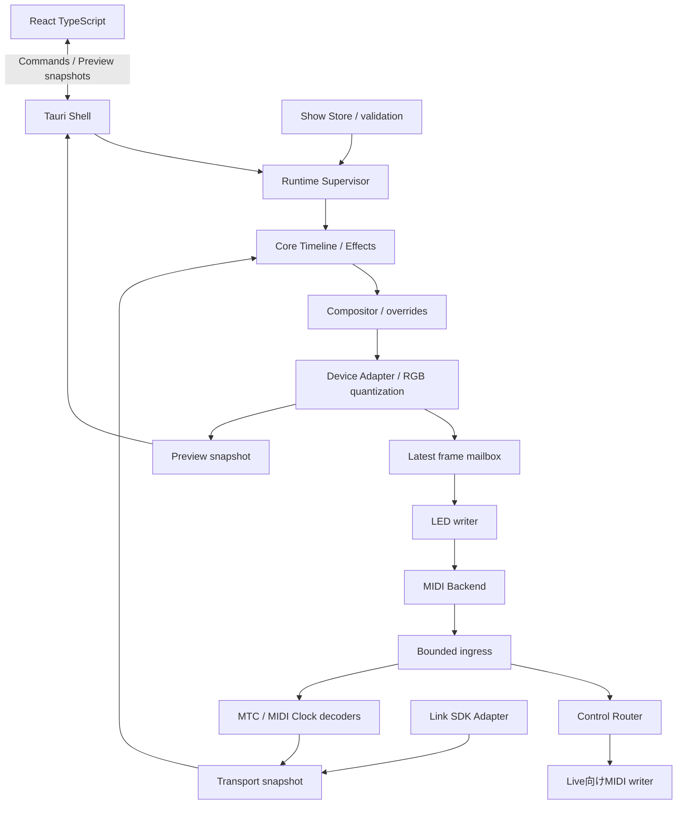

# OMOI-IRO システムアーキテクチャ

## 構成と依存方向

Coreは時刻を引数で受け取る評価器として構築する。OS時計、MIDIポート、ファイル、Tauriは外側の層で扱う。MVPは単一プロセス内の複数スレッドで実行し、別プロセスのエンジンサービスは導入しない。

依存はShell→Runtime→Coreへ向かう。Device AdapterはCoreのフレーム型を利用できるが、CoreはAdapterやMIDI backendを参照しない。SimulatorもCoreの同じrender経路を使用する。

## 時間のモデル

| 型 | 意味 | 発生源 |
| --- | --- | --- |
| `MonotonicTime` | セッション内で逆行しない観測時刻 | Runtimeが提供する単調時計 |
| `ShowTimeUs` | 共通タイムコード起点からの符号付きμs | Bridge decoder（Liveブリッジの曲中時刻サンプル）+ offset。2026-10-28改訂、[10-live-bridge.md](10-live-bridge.md)。MTC decoderは外部MTC源を受ける場合と自己検証用に残す |
| `BeatState` | BPM、四分音符位相、位置の有効性 | Link、MIDI Clock/SPP、またはSimulator |
| `TransportState` | stopped/playing/unknown | 同じLive由来のtransport通知と受信状態 |
| `SyncHealth` | unlocked/acquiring/locked/holdover/lost/fault | 時刻源と拍源それぞれ独立 |

時刻はUTCや`SystemTime`で進めない。内部はi64 μsと有理数fpsを基本にし、フレーム番号からの換算は累積加算を避ける。JSONの整数はJavaScriptで正確に保持できる範囲に制限する。

`show_time = bridge_song_time - timecode_origin + input_offset_us` と定義する（2026-10-28改訂。従来の `decoded_mtc_time` は外部MTC源を使う場合の式として残る）。正のinput offsetは演出の評価時刻を先へ進める。機器ごとの出力補正は端末設定に置き、このoffsetと二重に加算しない。原点より前はprerollとし、既定では黒を出力する。

GUIのフレーム描画回数で時間を進めない。ローカル時計、MTC時計、テスト用時計は同じsnapshot形式に変換する。外部追従中のGUIスクラブは独立プレビューとし、Liveや実機の演奏位置を書き換えない。

## MTC受信

2026-10-28の改訂：共通時計の第一の源はLiveブリッジのサンプルであり、MTCは本アプリが生成する出力になった（[10-live-bridge.md](10-live-bridge.md)）。この節のMTC受信は、外部のMTC源を使う構成と、自アプリのMTC出力をp0-probeで検証する用途に適用する。ブリッジ受信の健全性・不連続の規則は同じ考え方で定義してある。

Quarter FrameとFull Frameを別イベントとしてデコードする。8種類のQuarter Frameは2フレームにまたがるため、復元したラベルを最後のメッセージの到着時刻そのものと同一視しない。[MIDI Association](https://midi.org/midi-time-code)、[受信器実装の一次資料例](https://docs.rs/timecode-tools/latest/timecode_tools/mtc/index.html)

初期のアルゴリズム案は、正順の完全な系列からラベルと先頭pieceの受信単調時刻を組にし、その時点をアンカーとして現在時刻まで補間する方式。プロトコルの系列遅延補正、OS受信遅延、利用者のoffsetは別の項目として扱う。既存decoderが補正済みなら追加補正しない。特定crateの採用は別判断とし、既知メッセージ列と実送信器で時刻規約を照合する。

検証規則は次のとおり。

- 型0〜7の正順と値域を検証し、欠落・重複・順序逆転で不完全な組を破棄する。
- 2組の整合する系列を得てlockedへ移行する。受信開始直後は時間が有効でもacquiringとする。
- Full Frameは位置更新であり、Playと解釈しない。受信時に組立途中の系列をクリアする。
- fpsは24/25/30 NDF/30000÷1001 DF。29.97 DFを整数30 fpsで積算しない。10分ごとの例外と無効ラベルを検証する。
- fps変更、seek、loop、24時間境界は不連続として通知し、古い補間アンカーを破棄する。24時間境界のMVP方針は一周して再評価し、24時間を超える単調なショーは保証しない。
- 逆再生のQuarter FrameはMVPで検出・表示するが追従再生はしない。負方向の位置変更自体は通常のseekとして扱う。
- Full Frame中にReal Time byteが挿入されても壊れないよう、backendの配送単位に依存しないパーサー契約を定める。

開始・停止の通知源はLiveブリッジの`is_playing`とする（2026-10-28改訂。LinkのStart Stop Syncはアプリ側で有効にしない。外部MTC源を使う構成ではMIDI ClockのFA/FB/FCを代替にする）。Linkの途中参加では既存再生状態が自動共有されないため、初期値falseをLiveのStopと解釈しない。ブリッジの位置が進んでいればplayingを確認できるが、無通信だけで停止と断線を断定せず、同期断ポリシーを適用する。M3の実装規則：時刻側はLocked/Holdoverで再生中かつ前進していればfollow、Acquiring・停止（hold）・stalledはhold、`stop_behavior`がblackoutなら停止でblack、Lost/Faultは最終正常サンプルから`blackout_after_ms`までholdしてからblack、再点灯時は`recovery_fade_ms`でフェード。拍側はClockなら最終tickから外挿して3 tick以内locked、`holdover_ms`以内holdover、その後lost、`blackout_after_ms`で位相無効。Linkはpeerがいる間はlocked、喪失後は同じ規則。[Link Start/Stopの仕様](https://ableton.github.io/link/)

### 状態遷移の初期案

| 条件 | 時刻の扱い | LED |
| --- | --- | --- |
| 起動・未受信 | unlocked | 黒 |
| Full Frameのみ | 位置は更新、再生はunknown/stopped | その位置を評価。自走しない |
| 正常な2系列 | locked | 共通位置に追従 |
| 受信間隔が期待値を大きく超過 | holdover | 最終正常受信から最大250 msだけ補間 |
| 250 msを超えて無通信 | lost、位置保持 | 最後の評価フレームを保持 |
| 1 sを超えて無通信 | lost | 黒 |
| 正常Stop | stopped | 最終位置を保持。欠落として消灯しない |
| 再受信・2系列整合 | locked | 新位置へ復帰、100 msでフェード |
| 不正fps・逆方向系列 | fault | 補間を止め、同期断と同じ保持・消灯規則 |

250 ms、1 s、100 msは提案値であり、show設定またはアプリの既定値として管理する。送信器が停止中も時刻を送る場合の挙動はS03で確認する。

## BPMと拍位相

第一候補はLink Adapter。SDKのsnapshotからtempoと`phaseAtTime(t, 1)`を取得し、CoreのBeatStateへ変換する。Linkのbeat番号はこのアプリ固有なのでLiveの曲中の拍番号・小節番号として保存しない。SDK時計とRuntimeの単調時計を対応付け、GUIの更新周期から位相を求めない。App Session Stateの取得は専用処理で行い、renderへ有界snapshotを渡す。アプリはtempo・beat・transportをsessionへcommitしない。[Ableton C API](https://github.com/Ableton/link/blob/master/extensions/abl_link/include/abl_link.h)

Link自体に単一マスターはないため、Liveと本アプリだけのsessionを基本にする。peer数だけでLiveの身元や再生状態を証明できない。詳細は[Linkの採用案](08-ableton-link.md)。以下は代替のMIDI Clock Adapterの処理規約。

MIDI Clockのtick間隔からBPMを推定し、外れ値除去と緩やかな追従を行う。式の基本は `BPM = 60 / (24 × tick_interval_seconds)`。Startで拍位置を初期化し、Continueは保持位置または直前のSPPを使う。SPPは16分音符単位、1単位はClock 6個である。[MIDI Messages](https://midi.org/about-midi-part-3midi-messages)、[MIDI規格作業部会議長によるSPPの説明](https://midi.org/community/midi-software/midi-machine-control)

SPPの範囲や未受信・取りこぼしで絶対拍位置が不明でも、四分音符位相とテンポは別々に品質を示せる。受信途中参加を勝手に小節先頭としない。MVPのPulseは四分音符周期を基本とし、正確な小節頭を必要とする演出は位置が確定したときだけ有効にする。

MTCをBPMから推測して置換しない。Link/Clockのテンポ変更はBeatStateに反映し、時間ベースのclip開始時刻は保持する。拍入力は常に一つを選び、両方式を同時にCoreへ反映しない。LinkからMTCへの自動変換は行わない。

Clockの同期断にもshowのholdover/消灯期限を適用するが、影響するのは拍依存レイヤーだけとする。時刻と拍の最終正常受信時刻は個別に保持する。Start/SPP等で四分音符位相が確定していない途中参加では、推定BPMだけを表示しPulseを有効化しない。

Linkはpeerを失ってもローカルの拍時計が進むので、snapshotが新しいことを接続正常の根拠にしない。peer喪失通知から同期断期限を数え、拍レイヤーに同じholdover/消灯規則を適用する。Linkの途中参加では拍位相と再生状態の有効性を別に管理する。最後のpeer喪失検出までの時間も実測する。

## 再現可能な評価とレイヤー

評価は次の関数関係を基本とする。

`Frame = render(show_revision, show_time, beat_state, seed, override_state)`

クリップは半開区間 `[start_us, start_us + duration_us)` で有効。local timeは現在時刻との差から求める。前フレームの色や前回tickを効果の意味に含めない。Solid、秒周期Chaseは時刻だけで再評価できる。PulseはBeatStateを追加で要する。

乱数を使う将来の効果はseedと安定ID、時刻区間、LED IDから値を決め、render呼び出し回数に依存させない。状態を積み重ねる粒子系等は、解析的評価かcheckpoint+固定step replayを実装できる段階で追加する。

各レイヤーは透明RGBAフレームを返す。値は線形RGB 0〜1。色指定のsRGBから線形へ変換し、source-over計算ではpremultiplied alphaを使う。実装上の合成を以下に固定する。

- over：`Cp = Cs*As + Cd*(1-As)`、`A = As + Ad*(1-As)`。ここでCsは非乗算source色、Cdは乗算済みdestination色、Asはclip alpha×layer opacity。
- add：RGB寄与 `Cs*As` をdestinationに加え、最終出力時にclampする。alphaは合成対象のunionとする。
- max：乗算済みRGB各成分の最大値を取り、alphaも最大値とする。

clipのfadeはalphaへ適用する。同じレイヤー内の重複clipは配列順のover、レイヤー間は配列の先頭を下として順に合成する。配列順は意味を持つため、保存時にID順へ並べ替えない。master brightnessとBlackoutは合成後に適用する。

最終的に黒背景へ合成して不透明RGBにし、機器profileの変換を通してRGB7/パレットへ量子化する。実機の色域を厳密に再現する校正は後続作業とする。プレビューは「計算結果」と「機器変換後」を区別し、初期表示は機器変換後とする。

## TriggerとAction

Triggerは入力イベントを意味のあるActionへ変換する境界。初期実装は固定ルールとし、自由なルールエディターを作らない。

| Trigger | Action例 | 実行先 |
| --- | --- | --- |
| デバイスNote/CC | RouteMidi | 操作writer |
| UIのBlackout | SetBlackout | Runtime override |
| UIのプリセット適用 | ReplaceEffectParameters | 編集モデル |
| Transportのseek/loop | ReevaluateAt | Core |

タイムラインLEDは「時刻を跨いだら一度だけ発火するイベント」の集合にしない。任意位置から有効clipを検索して描画する。将来の外部Actionは、seek時に過去の副作用を再実行しない規約を持たせる。MVPのtimelineから外部MIDIを自動送信する機能は含めない。

## 実行とキュー

MIDI callbackは時刻採取、サイズ検証、受信データのコピー、bounded queueへの投入だけを行う。ディスク書込、GUI通知、render、送信待ちは行わない。可変長SysExは上限を設け、不正・過大メッセージを診断する。

| 経路 | 実行単位 | 詰まった場合 |
| --- | --- | --- |
| 操作入力→Live | 高優先の専用処理とwriter | 破棄を黙認しない。faultを通知、active noteを解放し経路を停止 |
| 同期入力→decoder | 順序付き専用処理 | 欠落としてrelock。古い時刻を再生しない |
| render | 単調時計を使う周期処理 | 遅れたframeを飛ばして現在位置を評価 |
| LEDフレーム→writer | 容量1の最新frame mailbox | 古いframeを上書き |
| コマンド | 小さなbounded queue | busyを返し、再送をUI側で判断 |
| プレビュー | 容量1のsnapshot、最大30 fps | 古いsnapshotを破棄 |
| 診断ログ | 別の低優先処理 | 繰り返しを集約し件数を保持 |

LED writerが保持する差分基準は「最後に送信が成功したフレーム」。render済みだが送信されなかったフレームを基準にしない。再接続、send失敗、モード変更、出力再開では差分キャッシュを無効にして全体を送る。パケット分割が必要なら世代番号を付け、途中で古い世代と新しい世代を混ぜない。

入力とLEDは別writerなので、長いLED SysExの待ちがLiveへのNote Offを止めない。同じ物理出力を共有する将来構成では、mode/blackout/通常frameの優先順位を1つのwriterで調停する。

## MIDI接続のライフサイクル

`Disconnected → Connecting → Identifying → Configuring → Ready → Recovering/Fault` を定義する。ポートを列挙し、手動選択とdevice inquiryで照合してからモードを変える。ポート名の部分一致だけで自動送信先を決定しない。endpoint IDは接続の手掛かりとして保存するが、OSを跨ぐ不変IDとは扱わない。

midirのcallback時刻は接続ごとの基準点を持つため、異なるポートの値をそのまま比較しない。Runtimeで共通単調時計に対応付け、再接続時に変換を再初期化する。同期ポートは`Ignore::None`を明示し、F1/F8/SysExが届くことを試験する。[midir MidiInput API](https://docs.rs/midir/latest/midir/struct.MidiInput.html)

終了時は新規操作を止め、転送したactive noteのNote Offを送る。必要なchannelだけpanic処理を行い、消灯、モード復帰、port closeへ進む。任意のLiveトラック全体へ無差別にAll Notes Offを送らない。切断やプロセスクラッシュでは送信できないため、次回起動の復旧操作と物理的な再接続手順も用意する。

## GUIとデータ変更

UIからのcommandは接続、読込、編集、保存、overrideの要求。Rust側で検証してからrevisionを更新する。編集モデルから実行用のimmutable showを構築し、frame境界で差し替える。重いJSON解析や保存はrender threadで行わない。

プレビューはTauri Channel経由のsnapshot配信を候補とする。高頻度MIDIイベントをGUIへ逐次送らず、状態と集計値を届ける。通常イベントは接続変化等に限定する。Tauri公式も通常eventを低遅延・大量ストリーミング用途としていない。[Tauri frontend通信](https://v2.tauri.app/develop/calling-frontend/)

フロントエンドではエフェクト計算を再実装しない。UI更新停止・最小化の影響を受けずにRust側の同期・送受信を継続する。単一プロセスのためプロセス全体のクラッシュからエンジンを隔離する保証はない。

## 拡張の方針

Device Adapterは座標、LED ID、入力能力、色形式、最大payload等を宣言する。矩形8×8をCoreの固定配列にせず、surface上のLEDリストとして扱う。F1や複数機器ではtargetごとにrenderし、機器固有の色変換と更新予算を適用する。

Effect、Trigger、Actionの公開境界は静的Rust型とregistryで開始する。Rustの動的ライブラリーABIを外部プラグイン契約にしない。外部プラグインが必要になった段階で、Wasmまたは別プロセスのversioned protocolを比較する。
