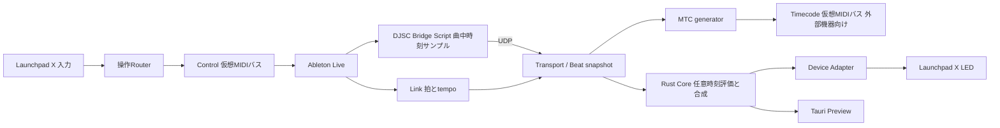

# OMOI-IRO Claude向け設計引き継ぎとP0実施仕様

## この文書の目的

Claudeが、この会話を読まずにプロジェクトの前提を理解し、次工程のP0技術検証に着手できるようにする。今回の引き継ぎ対象は環境確認、最小の同期モニター、Launchpad Xの疎通検証まで。完成版アプリの一括実装は対象外。

この文書とプロンプトを作成した時点では、アプリコード、Cargo workspace、Tauriプロジェクトは存在しない。既存成果物は設計文書、JSON Schema案、サンプルshowである。実際に作業を開始するときはファイルの最新状態を確認する。

## 確認済みの利用条件

| 項目 | 条件 |
| --- | --- |
| 音楽再生 | Ableton Live 12 Suiteをマスターとして使う |
| 演奏方式 | ArrangementとSessionを初期から同等に扱う |
| 演出の基準 | 両ビューともセット全体の共通タイムコード。個々のclipの再生位置を追跡しない |
| Launchpad X | アプリがProgrammer Modeで入力とLEDを管理し、操作をLiveへ転送する |
| 拍同期 | Ableton Linkを第一候補。MIDI Clockも代替として選択可能にする |
| 時刻同期 | 2026-10-28改訂：Live内のRemote Scriptが曲中時刻サンプルを送る自前ブリッジを共通時計の源にする。MTCはアプリが外部向けに生成する（[10-live-bridge.md](10-live-bridge.md)）。LiveMTCはテンポ変更で時刻が飛ぶため不採用 |
| 代替案 | LTC→MTC変換は条件付き代替のまま。LiveMTCは検証済みで不採用 |
| タイムコード | 30 fpsが暫定候補。正式なrate・開始時刻は未定 |
| Windows | 10または11を想定。build、CPU、driverの具体値は未確認 |
| macOS | Apple Silicon。OS版は未確認。Intelは初期検証対象外 |
| 実機 | MacとLaunchpad Xの検証環境あり。Macの放置運転は不可 |
| 技術 | Rust Core、Tauri 2、React / TypeScript。Linuxは将来検討 |

Macの試験は15〜20分程度の立ち会い枠に分割する案。短い試験の累積時間を連続安定性試験の代わりにしない。Windows実機が接続されているか、Windows環境を長時間占有できるかは未確認。

## システム設計の要点

MIDI入力転送、同期受信、エフェクト計算、LED出力を分ける。CoreはOS時計やMIDIポート、Tauriを参照せず、時刻と拍状態を引数で受け取る。GUIの描画周期で演出時刻を進めない。

最終アプリの初期構成は`show-core`、`show-devices`、`show-midi`、`show-store`、`show-runtime`の5ライブラリーとdesktop shell。P0ではこの全構成を先に生成せず、必要な接続とデコードだけを小さな検証ツールにする。

LEDは現在のshow timeから有効clipを検索し、local timeを計算して再評価する。最初はSolid、Chase、Pulse、64パッド、最大8レイヤー、30 fps更新を提案している。時刻ベースの効果は時刻から再現し、拍依存の効果は同じBeatStateも必要とする。

LED出力は最新フレームを優先する。差分の基準は最後に送信に成功したフレームであり、送信されなかったフレームではない。操作用Note OffをLED送信待ちで遅らせない。

## 同期方式で誤解してはいけない点

- Liveは標準でMTCを送信できない。共通時計はLive内スクリプトの曲中時刻サンプルから作り、MTCはアプリが生成する（2026-10-28改訂）。LiveMTCは拍×現在テンポで時刻を作るため、テンポ自動化のあるSetでは使えない。
- アプリ側でLinkのStart Stop Syncを有効にしない。Live 12.4.7のトランスポートが進まなくなる（S07実測）。
- Linkは拍とtempoの同期に利用する。Linkのbeat番号をLiveの曲中秒数や小節番号と同一視しない。
- LinkのStart Stop Syncを有効にしても、参加時の初期状態だけで相手の再生・停止を判断しない。
- Linkには排他的なマスター指定がない。アプリからtempo・beat・transport変更を送らず、Liveと本アプリだけのsessionを基本にする。
- MTCが途絶えたとき、Linkが進行していることを理由に共通タイムコードを自走させない。
- Sessionのclip変更だけで演出をゼロへ戻さない。共通transportのseekやloopには追従する。
- LinkとMIDI Clockを同時に拍入力として反映しない。自動fallbackは行わない。

根拠と詳細は[実現性調査](00-feasibility.md)、[アーキテクチャ](02-architecture.md)、[Link採用案](08-ableton-link.md)にある。採用する依存ライブラリーのAPIと対応環境は、実装時に一次資料で再確認する。

## P0の進行順序

### 1 環境確認

最初にリポジトリーの指示、既存変更、導入済みツールを確認する。Windows上で取得できる情報は読取専用の方法で取得し、利用者へ同じ情報を聞き直さない。

記録する項目はOS版・build・CPU、Rust/CargoとC/C++ビルド環境、Live/Maxの正確な版、audio driver、Linkの利用状態、仮想MIDIバス、Launchpad接続の有無。GUIでしか分からない項目やMacの情報は未確認として残し、実機試験時に確認する。機器の状態を確認せずにmode変更やLED送信を始めない。

成果物：`docs/validation/environment.md`。項目ごとに「取得値」「確認方法」「確認日」「未確認事項」を残す。読めない値を推測で埋めない。

### 2 最小の同期モニター

RustのCLIを優先する。候補配置は`tools/p0-probe/`で、P0専用の独立したCargo packageとする。ルートの完成版workspaceやGUIを作る必要はない。既に別の実装がある場合は重複作成せず、その境界を使う。

CLIはポート一覧、同期観測、記録、記録再生を扱う。以下は設計上の操作名であり、現時点で実行可能なコマンドではない。

| 操作名案 | 必要な動作 |
| --- | --- |
| `ports` | 入出力ポートを列挙。列挙だけでは機器へ送信しない |
| `monitor` | 指定したMTC入力と、選択したLinkまたはClockを同時観測する |
| `replay` | 保存済みイベントを入力にして、デコーダーの結果を再確認する |
| `lpx-check` | 選択した機器の識別、mode、RGB、入力、終了時復帰を確認する |
| `route-check` | 指定入力からControl出力へNote/CCを転送して記録する |

`monitor`ではBPM、四分音符位相、Link peer数、transport状態とその有効性、MTC raw label、fps、補間位置、同期品質、受信件数と欠落を表示する。ターミナル表示やログ書込がcallbackをblockしない構成にする。

P0は30 NDFの正常系列・Full Frame・seek・欠落から始めてよい。未対応fpsは明示し、別のfpsとして処理しない。製品MVPの24/25/29.97 DF/30対応は後続タスクであり、P0の30 NDF成功だけで全対応としない。

Link bindingはoptional featureにし、SDKのビルドで詰まってもMTC解析・記録再生・MIDI列挙を独立に進められるようにする。Linkの採用判断はビルドと実接続の結果を得てから行う。

### 3 Launchpad Xの疎通

ポート識別後、明示的に指定したLPX MIDI入出力だけを使う。device inquiry、mode照会、Programmer Mode、低輝度での単色点灯、パッド押下・解放、Liveへの操作転送を順に確認する。通常終了とCtrl+Cで消灯・mode復帰を試み、復帰に失敗した場合はその事実を表示する。

操作転送はNote/CCに限定し、Clock、MTC、機器制御SysExをLiveへ無差別転送しない。LED更新と入力を同時に動かし、重複転送やNote Off欠落がないか記録する。

Liveや機器の準備ができていなければ、ツールと操作手順を完成させ、実機項目を未検証として残す。機器がないことを理由に、完成版エンジンやGUIへ作業範囲を拡大しない。

### 4 両ビューの同期検証

同じLive Setで以下のケースを実施する。Windowsで実施できない場合も、Mac用に同じケースと期待結果を準備する。

| ケース | 観測したいこと |
| --- | --- |
| Play、Stop、再開 | MTC時刻とtransport通知の順序・遅延。誤った再生再開がないこと |
| 途中位置から開始、前後seek | 共通時刻が移動先へ復帰すること |
| 短いloop | loopごとに適切に位置が戻り、古い状態が残らないこと |
| BPM 120→128→90 | Link/Clockの拍が追従し、MTCに意図しないジャンプがないこと |
| Session clip変更とビュー切替 | clipごとの時刻リセットが起こらないこと |
| 再生途中でLink参加 | transport初期値をStopと誤解しないこと |
| MTC停止、Link peer喪失 | それぞれの同期品質を独立に判定できること |
| USB抜き差し | 接続世代を更新し、古い入力・時刻・LEDフレームを再送しないこと |

S01〜S07の正式な対応は[実装タスク](06-tasks.md)に従う。順番は「環境→同期モニター→LPX」を基本とし、機器を使える時間に合わせて独立した試験を入れ替えてよい。

## ログと結果の形式

機械可読ログはJSONLを候補とする。各行にrun ID、連番、共通の単調時刻、入力種別、event種別、payloadを含める。MIDIではraw bytes、Linkでは受信snapshotとpeer/transportの有効性を残す。異なるconnectionのbackend timestampをそのまま同じ時刻軸と扱わない。

生ログはローカルの`artifacts/p0/`等へ保存し、サイズの大きな記録を設計文書へ埋め込まない。合成fixtureにはsyntheticと明記し、実機取得のログと区別する。連番欠落や記録queue overflowは件数として残す。

結果表には、ケースID、環境、実行日時、期待結果、観測結果、pass/fail/not-run、証拠ログへの相対パス、次の判断を記載する。`not-run`は失敗でも成功でもない。Macの連続2時間試験は短時間の機能検証と別行にする。

## P0の納品物と完了判定

| 成果物 | 条件 |
| --- | --- |
| 環境調査 | `docs/validation/environment.md`に確認値と未確認値を分けて記載 |
| 最小ツール | 起動方法と必要依存を説明し、利用可能な環境でbuild/test結果を記録 |
| 検証手順 | `docs/validation/p0-runbook.md`にWindows接続手順とMacの短時間手順 |
| 検証結果 | `docs/validation/p0-results.md`に実測・合成テスト・未実施を区別 |
| 判断の更新 | `docs/07-decisions.md`の該当事項だけを証拠に基づいて更新 |

ツール実装完了、Windows機能検証完了、Mac機能検証完了、連続安定性検証完了は別々に報告する。両OSの接続や同期を試していなければ、全体の技術検証完了とはしない。

## この段階で作らないもの

完成版Tauri GUI、タイムラインエディター、全エフェクト、ノードグラフ、F1、OSC、複数機器、外部plugin host、LTC変換アプリの本実装はP0の対象外。P0で既存ブリッジが不適合と判明した場合は、記録を示して代替案を提案し、その方式が必要とする範囲を改めて決める。

日常的なモジュール分割、ログ形式の細部、テスト名などは担当エージェントの判断で進める。確認が必要なのは共通時計の意味を変える場合、対象機能を増減する場合、実機試験の時間を確保する場合など、利用者の運用へ影響する判断である。

## 読む順番

最初にこの文書と[設計判断](07-decisions.md)、[Link採用案](08-ableton-link.md)を読む。その後、接続とプロトコルは[実現性調査](00-feasibility.md)、同期状態機械は[アーキテクチャ](02-architecture.md)、試験条件は[PRD](01-prd.md)と[ロードマップ](05-roadmap.md)を参照する。

P0のために[完成版のcrate構成](03-modules.md)を全部生成する必要はない。[show仕様](04-show-data.md)、[Schema](../schemas/show.schema.json)、[サンプル](../examples/demo.show.json)は後続実装の契約として保持する。
