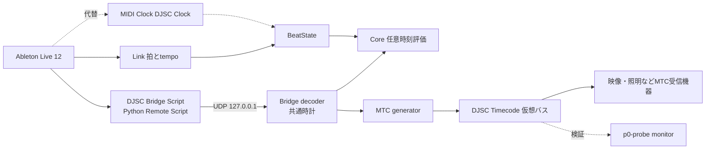

# OMOI-IRO Liveブリッジ仕様（共通時計の改訂）

確定日：2026年10月28日。利用者の決定：共通時計の源は「Live内スクリプトが送る曲中時刻サンプル」とし、MTCは本アプリが生成する出力形式にする。LiveMTCは採用しない。根拠は [validation/p0-results.md](validation/p0-results.md) のS04 C4（LiveMTCの時刻は拍×現在テンポで、テンポ変更時に飛ぶ）とO12節（Live APIの曲中時刻はテンポ自動化をまたいで連続、約60 Hz、残差p95 4.2 ms）。

この文書は [00-feasibility.md](00-feasibility.md)、[02-architecture.md](02-architecture.md)、[08-ableton-link.md](08-ableton-link.md)、[09-claude-handoff.md](09-claude-handoff.md) の「共通時刻はMTC受信」という記述に優先する。変更しない前提：Liveが再生マスター、両ビューはセット全体の共通時刻に追従、Linkは拍・テンポ専用、Clockは代替の拍入力、LPXはアプリが管理。

## 構成

Liveからアプリへは「曲中時刻・拍・テンポ・再生状態のサンプル」が入る。MTCはアプリから外へ出る。アプリ自身は自分が生成したMTCを入力に使わない。

## Live側スクリプト（DJSC Bridge Script）

形式はPython MIDI Remote Script。Max for Liveに依存しないので、Suite以外の版でも動く。P0実験の `tools/live-bridge-probe/DJSCBridgeProbe` を出発点にする。

| 項目 | 仕様 |
| --- | --- |
| 配置 | User Libraryの `Remote Scripts\DJSCBridge\`。PreferencesのControl Surfaceに割当、Input/OutputはNone |
| 読む値 | `Song.get_current_smpte_song_time(ms_time)`（テンポマップ反映の曲中時刻、ms）、`current_song_time`（拍）、`tempo`、`is_playing`、拍子（`signature_numerator` / `signature_denominator`）、ループ（`loop`、`loop_start`、`loop_length`、拍単位） |
| 送る契機 | (1) `current_song_time` リスナー（再生中約60 Hz）、(2) `is_playing` / `tempo` リスナー（変化時）、(3) 100 ms周期のタイマー（停止中・録音中の生存確認と補完） |
| 送り先 | UDP、既定 `127.0.0.1:9007`。1レコード1データグラム、JSON、UTF-8、512 byte以下。受け手がいなくてもエラーにしない |
| レコード | `v`（形式版）、`seq`（単調増加）、`kind`（`listener` / `timer` / `meta`）、`event`（`song_time` / `is_playing` / `tempo` / `tick` / `start` / `stop`）、`perf_ns`（Live側の単調時計）、`song_ms`、`beats`、`tempo`、`is_playing`、`sig`（例 `[4,4]`）、`loop`（`{on, start_beats, length_beats}`）、`errors`（読み取り失敗の項目名） |
| 禁止事項 | Liveのtransport・tempo・ループ・選択状態を変更しない。コールバック内でブロックする処理（ファイル同期書き、ネットワーク待ち）をしない |
| 障害 | 例外はすべて捕捉し、Log.txtへエラーだけ出す。スクリプトの異常でLiveを止めない |
| 既知の制約 | Arrangement録音中は `current_song_time` リスナーが止まる（P0実測）。タイマー送信で位置を補う。Liveのメインスレッド負荷が高いとサンプル間隔が伸びる |

ローカルへのJSONL記録はデバッグ用オプションにし、既定では送信だけにする。

将来、UDPが使えない構成（ネットワーク制限、別PC）向けに、同じレコードをSysExで `DJSC Timecode` 以外の専用バスへ送る変種を検討できる。P1では扱わない。

## アプリ側の受信と共通時計

Bridge decoderはMTC decoderと同じ役割（位置・健全性・不連続の判定）を、サンプル列に対して行う。

| 項目 | 仕様 |
| --- | --- |
| 時刻軸 | 到着時刻は共通の単調時計（`MonotonicTime`）。`perf_ns` はLive内のゆらぎ分析にだけ使い、到着時刻と直接比較しない |
| 共通時刻 | `show_time_us = song_ms × 1000 + input_offset_us`（Liveの曲頭 = show time 0）。showの `sync.origin`（例 `01:00:00:00`）は、曲頭に対応するMTCラベルであり、MTC出力では `label = origin + show_time` とする。timeline clipの時刻はshow timeで表す（2026-10-28修正。以前の式は符号が外部MTC受信の式のままだった） |
| 補間 | 再生中：`位置 = 最後のサンプルの song_ms + (now − 到着時刻)`。停止中：最後の位置を保持。`is_playing` はブリッジの値を正とする |
| 健全性 | `unlocked`（未受信）→ `acquiring`（1サンプル）→ `locked`（連続2サンプルの差が経過時間と20 ms以内で整合）→ `holdover`（再生中に50 ms無着、補間継続）→ `lost`（250 ms無着、位置保持）→ 1 sで消灯。停止中はタイマーの生存（500 ms以内）だけを見る。`fault`：`errors` あり、`seq` の大きな逆行、形式版不一致 |
| 不連続 | 再生中に `|Δsong − Δ到着| > 20 ms`、または停止中に位置が1フレーム超動いた場合に `discontinuity` を出し、局面（`playing` / `start` / `stop` / `stopped`）を付ける。Play直後はLiveが `is_playing=true` を先に出し、位置が6〜15 ms遅れて開始位置へ戻る（P0実測）ので、`is_playing` が true になってから50 ms以内の位置変化は `start` に分類する。テンポ自動化は不連続にならない。seek・loop折返し・手動テンポ変更は不連続になる。抑制はしない |
| 遅延補正 | Live内の値から到着までの遅延はP0実測でほぼ一定（残差中央値3 ms）。固定分は `input_offset_us` で吸収し、自動推定は行わない |
| Linkとの関係 | 拍・テンポはLinkまたはClockから取る。ブリッジの `beats` / `tempo` は拍入力の健全性確認と、Linkがない開発モードでの代替に使う。Start Stop Syncは使わない（S07でLiveが停止する問題） |
| 競合 | ブリッジの `is_playing=true` なのに位置が進まない（LiveのオーディオエンジンOFF、LinkのSSS待ち等）場合は `stalled` として表示し、再生扱いにしない。停滞中のタイマー由来サンプル（位置が動かない）を `discontinuity(playing)` に数えない |

## MTC出力（BetterLiveMTC相当）

| 項目 | 仕様 |
| --- | --- |
| 目的 | MTCを受ける外部機器（映像・照明）へ、Liveの曲中時刻をテンポ自動化に依存しない形で配る。アプリ内の時計はブリッジのサンプルを使い、この出力を自分で受信しない |
| 送信先 | 完全一致名で指定した出力ポート（既定 `DJSC Timecode`）。Launchpadらしい名前のポートは拒否 |
| レート | 30 NDF既定。24、25も選択可。29.97 DFは初期範囲外 |
| 時刻 | `label = show_time`（起点を含む）。起点はshowの `sync.origin` |
| Quarter Frame | 専用スレッドと高分解能タイマーで `1/(fps×4)` ごとに送る。送信時刻のジッター目標はp95 1 ms以内。ラベルは送信時点の補間位置から作り、piece 0の時刻規約（ラベルはpiece 0送出時のフレーム）に合わせる |
| 開始・seek・loop | 位置が1フレームを超えて飛んだとき、またはPlay開始時にFull Frameを送り、次のQuarter Frame境界からすぐ系列を再開する（LiveMTCの約0.45 s待ちを置かない）。受信側は2系列（約170 ms）で再lockできる。ブリッジ側が不連続の直後に1サンプル分 `acquiring` になる間（約17 ms）はQFを止めてよい。1サンプルだけの位置を外挿しない。Full Frameの理由は、直前が `locked` で再生中の不連続なら `jump`、Play開始なら `start`、停止中の移動なら `hold` と記録する |
| 停止 | `is_playing=false` でQuarter Frameを止め、停止位置のFull Frameを1回送る（受信側は位置保持）。停止中にLiveの位置が変わればFull Frameを送る |
| 同期断 | ブリッジが `lost` のときはQuarter Frameを止める（自走させない）。復帰時はFull Frame→系列再開。ブリッジから `meta stop`（スクリプト停止）を受けたら250 msを待たずに `lost` へ移してQFを止める（B4 C6の所見） |
| Play開始のFF | Liveは `is_playing=true` を先に出し、位置更新が6〜20 ms遅れて開始位置へ戻る（B4 C1の所見）。`is_playing` が true になったら、最初の位置更新を最大50 ms待ってからFull Frame(start)を1回出す。50 ms以内に来なければ現在位置で出す |
| 検証 | 出力をloopMIDI経由で `p0-probe monitor` に受け、ブリッジのサンプルと比較する。項目：lock所要時間、seek後の再lock時間、ラベルと位置の差、長時間のドリフト |

## P1での実装範囲（提案）

完成版crate構成はまだ作らない。`tools/` 配下の試作として次を作る。

1. `tools/live-bridge/DJSCBridge/`：上記仕様のRemote Script。P0の `DJSCBridgeProbe` を改名・整理（拍子・ループ・形式版の追加、JSONL記録の既定OFF）。
2. `p0-probe bridge-clock`：Bridge decoder（健全性、不連続、補間）と1秒ごとの表示、JSONL記録。既存の `bridge-listen` を置き換えるか拡張する。
3. `p0-probe mtc-out`：MTC出力。入力はブリッジ（UDP）。自己検証用に、同じプロセス内で出力の送信時刻とラベルを記録する。
4. 検証：runbook B2のC1〜C7をブリッジ＋MTC出力で再実施する手順と、合否基準（seek後の再lock 500 ms以内、残差p95 10 ms以内、2時間でドリフトなし）。

## 名前（2026-10-28、M5冒頭の改名）

この文書の `DJSCBridge` は `OmoiIroBridge`（`live-bridge/OmoiIroBridge/`、Liveの一覧表示も同名）、`DJSC Timecode` 等のポートは `OMOI-IRO Timecode` 等、`p0-probe` は `omoiiro-probe` に改名した。本文は履歴として旧名のまま。

## P1試作の状態（2026-10-28）

実装担当が1〜4を実装した（`live-bridge/DJSCBridge/`、`p0-probe bridge-clock` / `mtc-out` / `mtc-out-report`、合成送信器 `live-bridge/sim/fake_bridge.py`。M1でdecoderと生成器は `crates/show-runtime/src/sync/{bridge,mtc_out}.rs` へ移り、CLIは `apps/probe`）。p0-probe 86 tests、live-bridge 5 testsがpass（設計担当が再実行して確認）。合成源での自己検証：QF送信遅れ p95 0.14 ms、FF後の受信lock 125〜158 ms、ラベルとブリッジ位置の差 p95 0.5 ms。実測記録のreplayでは、テンポ自動化Set（bridge-03）の再生中不連続0、手動テンポ変更（bridge-01）で2件、Play直後の開始位置戻り（bridge-02）は `start` 2件。Full Frameの理由（hold / start / jump / stop / resync）と50 msの `start` 規則は実装済み（88 tests）。Live 12.4.7実機でのC1〜C7（runbook B4）は2026-10-28にすべて合格（[validation/p0-results.md](validation/p0-results.md) B4）。その後、`meta stop` 即lost、Play時のFF 50 ms待ち、停滞を不連続に数えない（静止した再生中サンプル対で補間を止め、QFをHold）の3点を実装し、記録のオフライン再生で確認した（96 tests）。改修後バイナリでのLive再確認、Mac、2時間試験は未実施。Live実機での再実施手順は [validation/p0-runbook.md](validation/p0-runbook.md) B4。

## 未確定と注意

- Remote Script APIはLiveの版で変わり得る。Live 12.4.7で確認した名前（`get_current_smpte_song_time`、`TimeFormat.ms_time`、`SmpteTime` の4属性、各リスナー）を `tools/live-bridge/README.md` に版ごとに記録する。
- Macでの配置先（`~/Music/Ableton/User Library/Remote Scripts/`）と動作は未確認。Mac枠M3で確認する。
- 手動のテンポ変更（自動化なし）ではLive自体の曲中時刻が飛ぶ。本番Setはテンポ自動化で運用する。
- 本アプリが生成するMTCを映像側が受ける場合、映像側の要求fpsと起点（O01）に合わせる。
